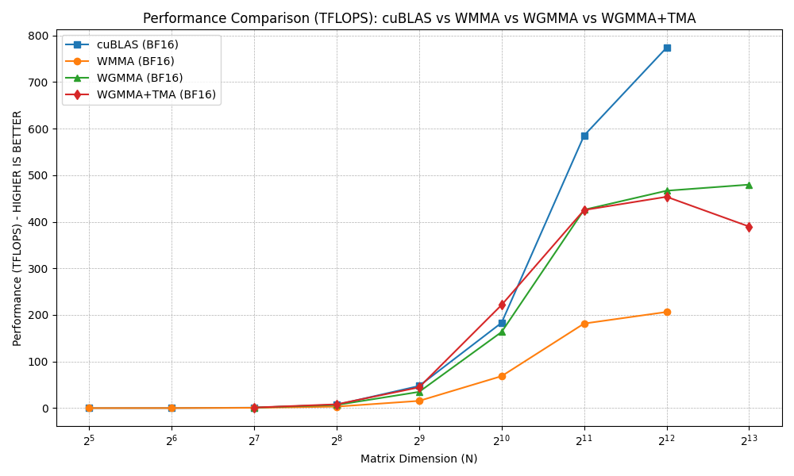
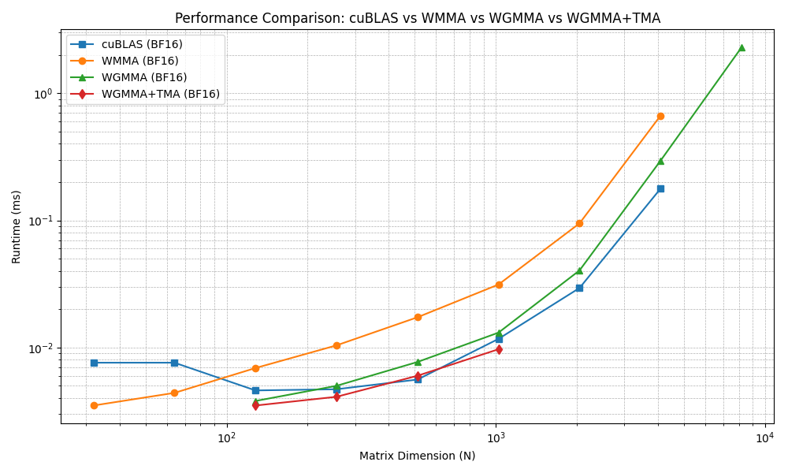

# CUDA Assignment — Matrix Multiplication on H100

**GPU**: NVIDIA H100 80GB HBM3 | **CUDA**: 12.4 | **Compute Capability**: sm_90

This repository provides a step-by-step exploration of Matrix Multiplication (GEMM) optimizations on modern NVIDIA Hopper (sm_90) architectures. It starts from a fundamental pedagogical baseline utilizing simple shared-memory tiling, progresses to warp-level operations (WMMA), and ultimately explores Hopper-native Warp Group MMA (WGMMA) asynchronous execution and Tensor Memory Accelerator (TMA) bulk transfers. The goal is to demonstrate the dramatic performance scaling achievable by natively leveraging these advanced hardware capabilities.

## Performance Overview

The graphs below capture the substantial performance improvements gained by transitioning from standard memory pipelines to hardware-accelerated asynchronous processing natively. The closed-source **cuBLAS** library represents the high-end baseline for comparison.

**Throughput (TFLOPS) vs. Matrix Dimension (Log-scale) — Higher is Better:**



**Execution Runtime (ms) vs. Matrix Dimension (Log-scale) — Lower is Better:**



---

## Approaches & Performance Ranking

| # | Folder | Technique | Est. Performance |
|---|--------|-----------|-----------------|
| 🥇 1 | [`02_cublas/`](02_cublas/README.md) | cuBLAS library | ~800–900 TFlop/s |
| 🥈 2 | [`06_wgmma_tma/`](06_wgmma_tma/README.md) | WGMMA + Tensor Memory Accelerator (TMA) | Highest Hopper-Native Peak |
| 🥉 3 | [`05_wgmma/`](05_wgmma/README.md) | Hopper WGMMA (Asynchronous MMA) | ~600–800 TFlop/s |
| 4 | [`04_thread_block_clusters/`](04_thread_block_clusters/README.md)| Thread Block Clusters + DSM *(Coming Later)* | TBD |
| 5 | [`03_wmma/`](03_wmma/README.md) | WMMA Tensor Core intrinsics | ~200–500 TFlop/s |
| 6 | [`01_tiled_shmem/`](01_tiled_shmem/README.md) | Simple shared-memory tiling | ~5–15 TFlop/s |

Each folder contains the `.cu` source and its own `README.md` with a detailed explanation.

### High-Level Overview of the Approaches:

*   **`01_tiled_shmem`**: A pedagogical baseline utilizing **simple shared memory tiling**. This technique maps small 2D patches of the matrix into shared memory to optimize global memory accesses, serving as the foundation for the more complex implementations.
*   **`02_cublas`**: Highly optimized closed-source library baseline provided by NVIDIA.
*   **`03_wmma`**: Introduces warp-level matrix multiplication using standard `wmma::` API. Incorporates multi-stage pipelining with `cp.async`, shared memory bank conflict resolution (padding), and L2 cache swizzling.
*   **`04_thread_block_clusters`**: *(Coming Later)* Introduces the `sm_90` feature where multiple thread blocks can read and write directly to each other's distributed shared memory (DSM) over the SM-to-SM network. This approach is not currently added and will be added later.
*   **`05_wgmma`**: Bypasses the `wmma` abstractions and register file limits by using Hopper-native `wgmma.mma_async` instructions, reading directly from shared memory into the Tensor Cores.
*   **`06_wgmma_tma`**: Combines WGMMA with the **Tensor Memory Accelerator (TMA)**, replacing `cp.async` with fully asynchronous hardware-driven block transfers from Global to Shared memory.

---

## Project Structure

```text
cuda-assignment/
├── 01_tiled_shmem/                # Simple shared-memory tiling
├── 02_cublas/                     # cuBLAS baseline
├── 03_wmma/                       # WMMA Tensor Core intrinsics
├── 04_thread_block_clusters/      # Thread Block Clusters + DSM (Coming Later)
├── 05_wgmma/                      # Hopper WGMMA (Asynchronous MMA)
├── 06_wgmma_tma/                  # WGMMA + TMA copies
├── build/                         # Compiled binaries
├── include/
│   └── utils.cuh                  # Shared macros (CUDA_CHECK) and utilities
├── results/                       # Data are created in this output folder (Profiling/Benchmark outputs)
├── plot_all.py                    # Script to plot benchmarking data across all kernels
├── plot_results.py                # Script to plot performance charts
└── Makefile                       # Automated build system
```

Adding a new approach: drop a new folder + `.cu` file — the Makefile picks it up automatically.

---

## Benchmarking & Graph Building

Once you benchmark the targets, performance CSV data are logged. The finalized benchmark charts and output data are created in an output folder named `results/`. 

To visualize the performance (e.g., Matrix Dimensions vs. Runtime or Matrix Dimensions vs. TFlop/s), you can use the provided Python scripts:
```bash
# Build and run your benchmarks to generate data (e.g., inside build/ or results/)
make run_all

# Run the Python plotting scripts
python3 plot_all.py 
python3 plot_results.py
```
This parses the performance CSV data and generates PNG graphs comparing the implementations on a log scale across various matrix dimensions.

---

## Build Commands

| Command | Description |
|---------|-------------|
| `make` | Release build of **all** targets |
| `make 01_tiled_shmem` | Build one specific target |
| `make run_01_tiled_shmem` | Build + run one target |
| `make debug` | Debug build of all targets (for cuda-gdb) |
| `make sanitize` | Memory + race checker on all targets |
| `make profile` | Nsight Systems profile of all targets |
| `make clean` | Remove `build/` artifacts |

```bash
# Build everything
make

# Build and run specific approaches
make run_01_tiled_shmem
make run_05_wgmma
make run_06_wgmma_tma
```

---

## Debugging & Memory Checking

```bash
make debug
cuda-gdb ./build/01_tiled_shmem_debug
```

```bash
make sanitize
```
